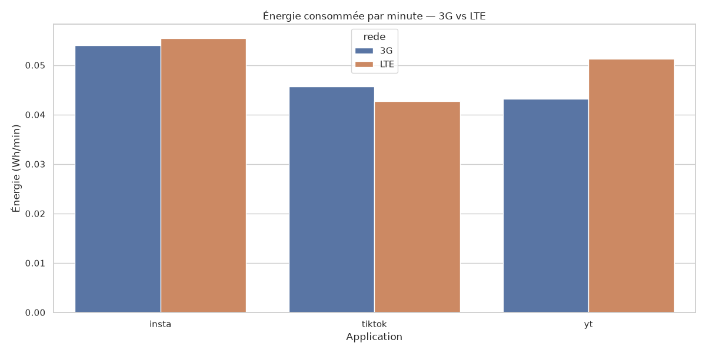
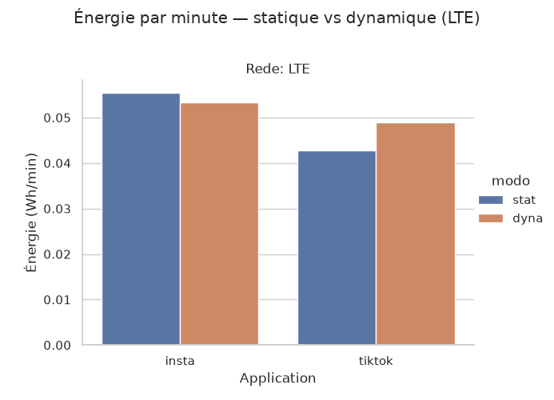

# Smartphone Network Energy Analysis (SIR)

> Team project · INSA Lyon, Telecommunications department (4TC) · 2024–2025
> 🇫🇷 Version française : [README.fr.md](README.fr.md)

How much energy does a smartphone actually spend watching short videos, streaming, or making a call — and how much of that goes to the cellular radio? This project answers it with **hardware measurements on instrumented phones**, not theoretical models, and turns the results into a **web simulator** that estimates the energy, battery percentage and CO₂ of a day of phone use.

<p align="center">
  
  
</p>

## How it works

```
Instrumented phone ──► PAC1954 power sensor ──► Raspberry Pi ──► CSV (64–256 samples/s)
                                                                    │
                     Python notebooks (energy per component, J/min) ◄┘
                                    │
               *_scenario_summary_df.csv ──► Express API ──► Web simulator
```

- **Measurements.** Phones (Google Pixel 6 Pro, iPhone X / 12 mini, Fairphone) have their internal power lines tapped. A PAC1954 sensor records voltage, current and power for the battery (`BAT`), the baseband processor (`BB`) and the RF power amplifier (`PA`).
- **Scenarios.** Instagram Reels, TikTok, YouTube Shorts, video streaming, voice and video calls, on 3G / LTE / 5G, both static and while moving (tram line T1 across Lyon).
- **Processing.** The notebooks split each recording into its useful window, integrate power into energy per component, and export one summary table per usage category.
- **Simulator.** The user picks a phone, a network and a mobility state, schedules activities over a day, and gets the energy (Wh), the % of battery used and a min–max CO₂ estimate.

## Key findings (short-video apps, Pixel 6 Pro)

Energy is normalised **per minute**, since sessions last from about 1 to 24 minutes.

- Scrolling short videos costs about **0.04–0.06 Wh per minute** (≈ 2.5–3.3 W on average), roughly 3 Wh per hour. Instagram is the most expensive of the three apps.
- **No network is consistently cheaper**: LTE costs about 3 % more than 3G on Instagram and 19 % more on YouTube Shorts, but 7 % less on TikTok.
- **Mobility had no clear effect**: on the tram, Instagram used 4 % less energy per minute than when static, and TikTok used 15 % more.
- These are 1–3 sessions per configuration, so the differences above are indicative rather than statistically established.

## My contribution

- **Comparative energy analysis**: [`analise.py`](analise.py) computes the energy per minute of every Reels session and compares apps × network (3G vs LTE) × mobility (static vs moving). It generates the figures in [`resultados/`](resultados/).
- **Large-dataset processing and visualisation**: [`processing_ready.ipynb`](processing_ready.ipynb) processes multi-million-row recordings in chunks, downsamples them for interactive Plotly charts ([`resultados/graficos_html/`](resultados/graficos_html/)) and exports the scenario summary.
- **Simulator**: device battery specifications ([`batteries_ue.csv`](website/server/batteries_ue.csv)) and front-end fixes (activity timeline).

## Repository layout

```
├── analise.py                      # Energy comparison: app × network × mobility
├── analyse_v2.py
├── processing_ready.ipynb          # Chunked processing + interactive plots
├── *_processing.ipynb              # One processing notebook per usage category
├── utils.py                        # CSV parsing and energy integration helpers
├── resultados/                     # Generated figures (PNG + interactive HTML)
├── scripts/planning_gantt.py       # Project timeline
├── website/
│   ├── client/                     # Simulator front-end (HTML, CSS, JS)
│   └── server/                     # Express API (/calculate) + scenario CSVs
└── data/Experiment_Data/           # Raw measurements (git submodule, see below)
```

## Running it

**Simulator**

```bash
cd website && npm install           # express, cors, body-parser, csv-parser
cd server && node server.js         # API on http://localhost:5000 (run from website/server)
# in a second terminal:
cd website/client && npx serve      # front-end on http://localhost:3000
```

**Analysis**

```bash
git submodule update --init         # fetch the raw measurements (~11 GB)
pip install pandas seaborn matplotlib plotly
python analise.py                   # figures are written to resultados/
```

## Data

The raw measurements belong to the research dataset of Youssef Badra (INSA Lyon / Inria, CITI lab) and are hosted at [gitlab.inria.fr/youssef.badra/Experiment_Data](https://gitlab.inria.fr/youssef.badra/Experiment_Data). They are linked here as a git submodule and not redistributed. The column format is documented in `data/Experiment_Data/README_File_Format.md`.

## Team and credits

Built by a team of INSA Lyon students: [Tom Goarin](https://github.com/ccanela/SIR/commits?author=tom%20goarin), [ccanela](https://github.com/ccanela) (original repository: [ccanela/SIR](https://github.com/ccanela/SIR)), Daniel Cury and teammates.

## References

- Y. Badra, R. Stanica — *Experimental Analysis of Energy Consumption in Video Streaming Services*. INSA Lyon, Inria, CITI.
- Y. Badra, R. Stanica — *A Comparison of Energy Consumption in Voice Call Services*. INSA Lyon, Inria, CITI.
- I. Ahmed et al. — *Lowering and Analyzing the Power Consumption of Smartphones*, Springer, 2023. [doi:10.1007/978-3-031-50327-6_29](https://doi.org/10.1007/978-3-031-50327-6_29)
